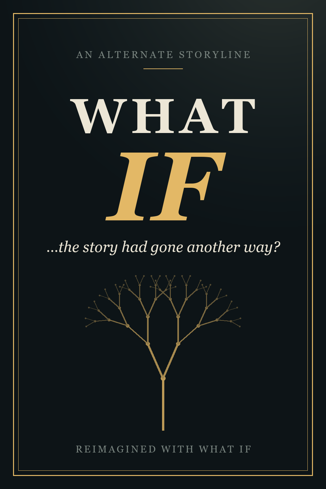
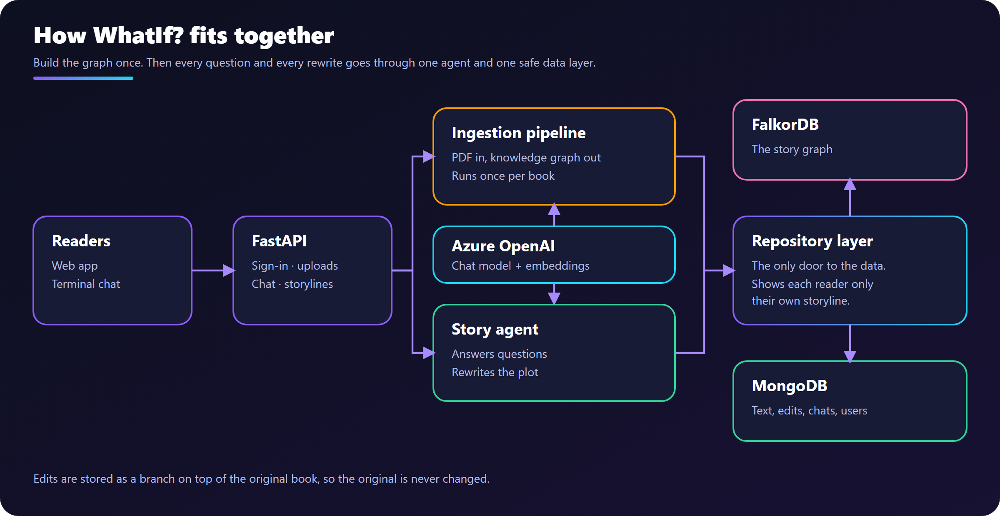
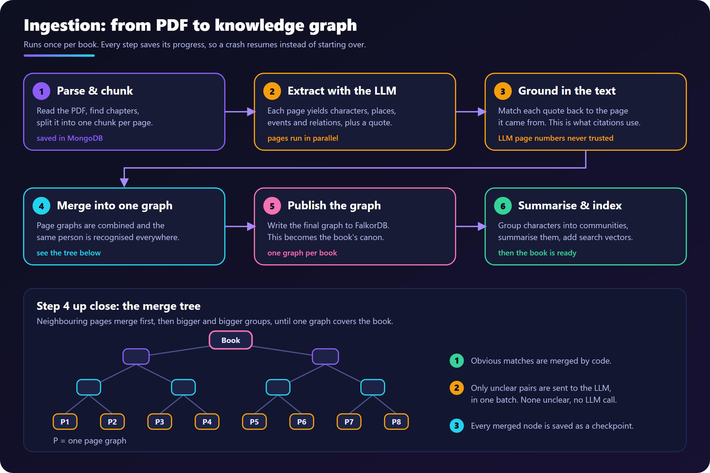
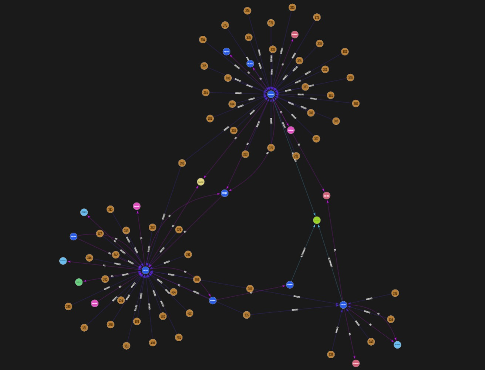
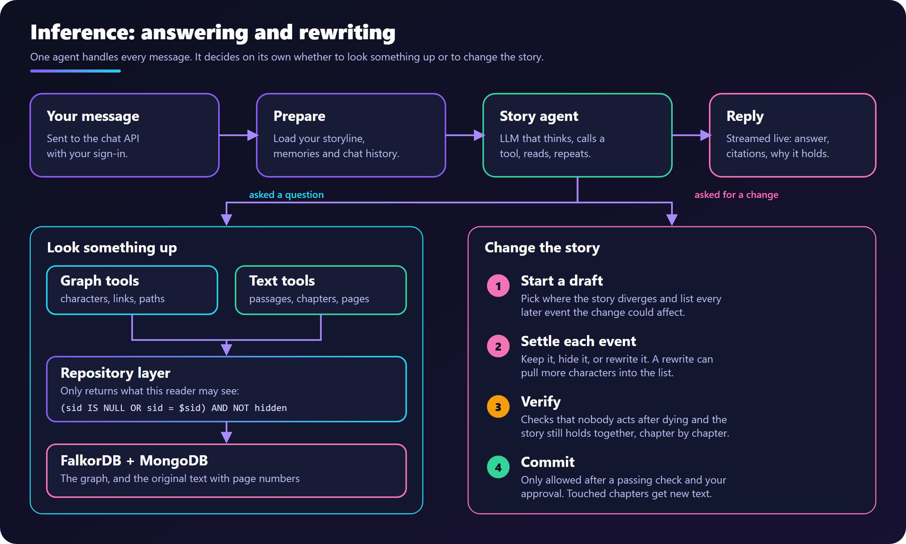
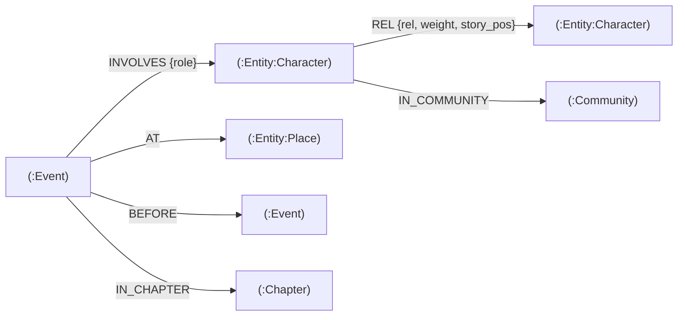

<div align="center">



# WhatIf?

### Read any book. Ask it anything. Then change what happens.

**WhatIf? is an app where you upload a book, chat with it, and rewrite its story.**
Ask who a character is or how two people are connected, and get an answer that points to the exact
chapter and page. Then ask a "what if" ("what if Voldemort never died?") and the app works out how
the rest of the story changes, keeping your version separate so the original book is never altered.

Under the hood, each book is turned into a knowledge graph of its characters, places and events,
and an AI agent reads and edits that graph on your behalf.

<p>
  
  
  
  
  
  
</p>

**[▶ Watch the demo](https://youtu.be/vSfYoqRjHH8)** &#183; **[Read the blog post](https://medium.com/@pragati_aliani/what-if-voldemort-never-died-building-whatif-an-app-that-rewrites-books-43c60857e659)**

[The problem](#the-problem) &#183; [What WhatIf does](#what-whatif-does) &#183; [Architecture](#architecture) &#183; [Graph data model](#graph-data-model) &#183; [Cypher & algorithms](#cypher-queries-and-graph-algorithms) &#183; [Run it](#run-it-locally)

</div>

## Demo

- **Video walkthrough:** https://youtu.be/vSfYoqRjHH8
- **Blog post:** [What if Voldemort never died? Building WhatIf, an app that rewrites books](https://medium.com/@pragati_aliani/what-if-voldemort-never-died-building-whatif-an-app-that-rewrites-books-43c60857e659)

---

## The problem

Books are fixed, but readers keep asking "what if?" What if the hero had made the other choice? What
if a character who died had lived? Today there are two ways to explore that, and both fall short.

| Approach | Where it breaks |
|---|---|
| **Chat with a book using plain RAG** | It retrieves a few similar paragraphs. It can't follow a character through 700 pages, can't answer "how are these two people connected?", and often makes things up without saying where from. |
| **Ask an LLM to rewrite the story** | It forgets the book. A character who "lived" still dies in chapter 20, other characters act as if nothing changed, and nothing says which parts of the original it overwrote. |

A good "what if" is not a single changed sentence. It is a **ripple**: every later event that involved
the changed characters has to be kept, dropped or rewritten, and the result has to still make sense.

## What WhatIf does

WhatIf solves both halves of the problem.

1. **It understands the book as a graph, not a pile of text.** Characters, places, events and
   relationships are extracted from every page and merged into one knowledge graph for the whole
   book. Every fact keeps the quote and page it came from, so answers can cite their evidence.
2. **It treats a rewrite as a branch, never an overwrite.** A storyline records only what it
   *adds* or *hides*. The original ("canon") stays untouched, so you can run many alternate versions
   side by side.
3. **It makes a rewrite follow through.** A change queues every later event it could affect, the agent
   settles each one, and a verification gate has to pass before the new version is saved.

| | |
|---|---|
| **Grounded Q&A** | Answers come from the graph and the original text, with chapter and page citations. Big-picture questions use community summaries. |
| **Storylines** | Say "what if Ravi never left Delhi?" and the story is rewritten from that point on, including new chapter text. |
| **Sharing** | Catalog books are shared by everyone. Uploads and storylines are private unless the owner shares them. |
| **Memory** | Signed-in users keep preferences across chats (explicit ones at once, inferred ones only after repeated evidence). |
| **Publish** | Optionally send a book or storyline to Inkitt. |

---

## Architecture

WhatIf is three ideas wired together: a **pipeline** that builds the graph once, an **agent** that
reads or rewrites it per question, and a **repository layer** that guarantees a storyline can never
leak into canon or into someone else's storyline. The three diagrams below go from the big picture
down to each pipeline.

### 1. The big picture

<p align="center">
  
</p>

Requests flow top to bottom.

- **Clients.** A React web app (library, reader, graph view, storyline workspace) and a terminal chat
  talk to the same API.
- **FastAPI gateway.** Handles sign-in (JWT plus a refresh cookie), uploads, chat, storyline
  management and memories. Every request gets an `X-Request-ID` that follows background work too.
- **Core services.** Three pieces do the real work:
  - the **ingestion pipeline** turns an uploaded PDF into a graph, as a background job;
  - the **Book Q&A agent** answers every chat message;
  - the **storyline engine** is the draft, verify and commit workflow the agent drives when you ask for a change.
- **MCP tool server.** The agent doesn't touch databases. It calls tools (graph, text, session,
  storyline) exposed over MCP. `book_id` and `session_id` are filled in by the app on every call, so
  the model can't pick another book or storyline.
- **Repository layer.** The only door to the data. It adds the storyline filter to every query,
  checks access, and writes the op log to Mongo *before* the graph.
- **Stores.** **FalkorDB** holds one graph per book (`book_{id}`). **MongoDB** holds text, evidence, merge
  checkpoints, storyline op logs, sessions, messages and chat checkpoints.
- **External.** Azure OpenAI provides the chat model and embeddings. Inkitt is optional.

### 2. Ingestion pipeline: from PDF to graph

<p align="center">
  
</p>

Ingestion runs once per book and takes the book through the statuses `queued → parsing → extracting →
merging → indexing → ready`. The UI follows it live.

1. **Parse & chunk.** Text and chapters are pulled from the PDF, every character is mapped to a
   page, and the book is split into one chunk per page. Chunks are saved once, so reruns reuse them.
2. **Extract.** The LLM reads pages in parallel batches and returns characters, places, events and
   relations, each with an **evidence quote**.
3. **Ground.** Each quote is fuzzy-matched back to the page text to find the real offset and page.
   Page numbers written by the LLM are never trusted. This is what makes citations reliable.
4. **Merge.** Neighbouring page graphs merge in a binary tree until one graph covers the book.
   Obvious duplicates (same name and type) are merged in code. Only genuinely ambiguous pairs go to
   an LLM judge, in one batched call per merge, and a "same" verdict is applied only at high
   confidence. Each merged node is saved as a checkpoint, so a crashed run resumes from the nodes
   already done.
5. **Publish.** The final graph is written to FalkorDB as the book's canon.
6. **Summarise & index.** Entities are clustered into communities, each with an LLM summary that
   big-picture questions use. Entities, events and passages are embedded for semantic search (if
   embeddings aren't configured, the book falls back to keyword search). The book is then `ready`.

**What the result looks like.** This is part of a real book graph, opened in the FalkorDB browser
(http://localhost:3000):

<p align="center">
  
</p>

The large hubs are the main characters. The numbered orange nodes around them are events, each
linked to the characters who take part in it (`INVOLVES`). The coloured nodes are other characters,
places and groups, joined to each other by relationships such as friend, enemy or parent (`REL`).
Every one of these links keeps the quote and page it was extracted from.

### 3. Inference pipeline: from question to answer (or rewrite)

<p align="center">
  
</p>

Every chat message goes through the **same agent**. There is no mode switch. The agent decides from
your message whether to look something up or to start rewriting.

- **Prepare.** The session tells the app which book and which storyline (if any) this chat is in.
  The user's memories are added to the prompt, and the chat history is restored from the
  checkpointer, folded into a rolling summary when it gets long.
- **ReAct loop.** The model writes a short reason, calls a tool, reads the result and repeats until
  it can answer. Guardrails wrap each model call: history summarization, a call limit, repair of
  malformed tool calls, planning tools (`write_todos`, `think_tool`) and logging.
- **Read path.** Graph tools walk entities, neighbours and paths. Text tools fetch the source
  passages and chapter summaries. Every graph query is filtered to what this reader may see:
  `(sid IS NULL OR sid = $sid) AND NOT hidden`.
- **Edit path.** For a "what if":
  1. `start_draft` anchors the change at an event and queues every later event and relation that
     involves the affected characters.
  2. `resolve_item` keeps, hides or rewrites each one, and can pull more characters in.
  3. `verify_draft` runs code checks (for example, nobody acts after being recorded dead) and an LLM
     continuity check per chapter.
  4. `commit_draft` is refused unless the latest verification passed on the current draft, and it
     waits for your approval.
  5. The chapters the change touched get new text, so one approval updates both the story record
     and the prose.
- **Response.** You get the answer with citations, a short chain of graph relations explaining why
  it holds, and a trace of every tool call. Messages are saved to Mongo. Over SSE the client receives
  `phase`, `step`, `token` and finally `done` events.

### How a storyline stays safe

| Rule | How it is enforced |
|---|---|
| Canon is immutable | Storyline items are tagged with a `sid` and the op that created them. Removals are a per-storyline hidden set. |
| The op log is the truth | Ops are written to Mongo before FalkorDB, so any storyline graph can be rebuilt from canon plus its ops. |
| No leaking between storylines | All reads go through one repository filter, and a test checks that one storyline's content never shows up in another's answers. |
| Pages come from evidence | Page numbers are derived from matched quotes, never from LLM output. |
| Heavy storylines scale | Past about 500 ops, a storyline switches from delta mode to a copied graph. |

---

## Graph data model

Each book is its own FalkorDB graph, named `book_{book_id}`. Canon and every storyline of that book
live in the same graph; storyline items are told apart by a `sid` property (see
[storyline scoping](#storyline-scoping) below).



### Nodes

| Label | Properties | Notes |
|---|---|---|
| `:Entity:<Type>` | `key`, `name`, `type`, `aliases`, `description`, `first_page`, `last_page`, `mention_count`, `community_id` | `<Type>` is one of `Character`, `Place`, `Organization`, `Group`, `Object`, `Concept`, added as a second label. Indexed on `key`. |
| `:Event` | `key`, `summary`, `story_pos`, `story_time`, `chapter`, `first_page` | `story_pos` is a float giving narrative order, so new storyline events can slot between canon ones. Indexed on `key`. |
| `:Chapter` | `title` | One per chapter found while parsing. |
| `:Community` | `cid`, `title` | One per detected group; its LLM summary is stored in MongoDB. |

### Relationships

| Pattern | Properties | Built by |
|---|---|---|
| `(:Entity)-[:REL]->(:Entity)` | `id`, `rel`, `description`, `weight`, `story_pos` | The LLM, during extraction. `rel` comes from a fixed vocabulary of 34 types (`FRIEND_OF`, `ENEMY_OF`, `PARENT_OF`, `LOVES`, `KILLS`, `BETRAYS`, `LIVES_IN`, ...); anything else becomes `OTHER`. |
| `(:Event)-[:INVOLVES]->(:Entity)` | `role` | Code, from each event's participants. |
| `(:Event)-[:AT]->(:Entity)` | | Code, from the event's place. |
| `(:Event)-[:BEFORE]->(:Event)` | | Code: a chain through all events in `story_pos` order. |
| `(:Event)-[:IN_CHAPTER]->(:Chapter)` | | Code, from the event's chapter. |
| `(:Entity)-[:IN_COMMUNITY]->(:Community)` | | Community detection (below). |

Story relations are kept as one `REL` type with a `rel` property rather than 34 edge types, so a
single pattern (`-[r:REL]-`) walks every kind of relation and `r.rel IN $types` narrows it.

### Storyline scoping

Every node and `REL` edge may also carry `sid` (the storyline that created it) and `created_by_op`
(the op number). Canon items have no `sid` and are never modified. What a storyline *removes* is
not deleted from the graph: it goes into per-storyline hidden sets of node keys and edge ids, kept
in MongoDB with the op log.

### What lives in MongoDB instead

FalkorDB holds only the graph the agent queries. MongoDB holds: books and their page
chunks, evidence quotes and mentions (each fact's page and offset), the merge tree checkpoints
(`graph_levels`, from which the graph can be republished at any time), community summaries,
embedding vectors, storylines and their op logs, chat sessions, messages and users.

---

## Cypher queries and graph algorithms

All graph access goes through `app/repo/graph.py`. Reads use `ro_query`; every query is
parameterised, and the only interpolated text is labels and predicates built from constants.

### The visibility filter

Every read includes this predicate for each node and edge alias it matches, so a reader can only
ever see canon plus their own storyline:

```cypher
-- canon
n.sid IS NULL

-- inside a storyline
(n.sid IS NULL OR (n.sid = $sid AND n.created_by_op <= $max_op))
  AND NOT (coalesce(n.key, '') IN $hidden_nodes)
  AND NOT (coalesce(n.id, '')  IN $hidden_edges)
```

`$max_op` lets a draft leave out ops that are not committed yet.

### Writing the graph (publish)

Ingestion writes the merged book graph in batches with `UNWIND` + `MERGE`, so publishing is
idempotent and safe to rerun:

```cypher
CREATE INDEX FOR (n:Entity) ON (n.key)
CREATE INDEX FOR (n:Event) ON (n.key)

UNWIND $rows AS row
MERGE (n:Entity:Character {key: row.key})
SET n += row

UNWIND $rows AS row
MATCH (a:Entity {key: row.src}), (b:Entity {key: row.dst})
MERGE (a)-[r:REL {id: row.id}]->(b)
SET r.rel = row.rel, r.description = row.description, r.weight = row.weight,
    r.story_pos = row.story_pos, r.sid = row.sid, r.created_by_op = row.created_by_op

UNWIND $rows AS row
MATCH (e:Event {key: row.event}), (n:Entity {key: row.entity})
MERGE (e)-[r:INVOLVES]->(n)
SET r.role = row.role

UNWIND $rows AS row
MATCH (e:Event {key: row.event})
MERGE (c:Chapter {title: row.chapter})
MERGE (e)-[:IN_CHAPTER]->(c)
```

`AT` and `BEFORE` edges are written the same way.

### Reads the agent's tools depend on

| Query | Used for |
|---|---|
| One hop over `REL`, both directions, strongest first | `get_neighbors`, and each level of `find_path` |
| An entity's events with its role, in narrative order | "What does X do?", character arcs |
| Events and relations after a point that involve given entities | The storyline ripple |
| Name, aliases and mention count of every entity | Fuzzy name matching in `find_entities` |
| Events of one chapter with their participants | Chapter questions, prose rewriting |
| The whole visible graph | The graph view in the web app |

```cypher
-- expand: one hop out of a set of entities
MATCH (n:Entity)-[r:REL]-(m:Entity)
WHERE n.key IN $keys AND r.rel IN $rel_types AND <visible n, r, m>
RETURN n.key, properties(r), startNode(r).key, endNode(r).key, properties(m)
ORDER BY r.weight DESC

-- entity_events: what a character does, in story order
MATCH (e:Event)-[i:INVOLVES]->(n:Entity {key: $key})
WHERE <visible e, n>
RETURN properties(e), i.role ORDER BY e.story_pos

-- events_involving: every later event a change could affect (the ripple)
MATCH (e:Event)-[:INVOLVES]->(n:Entity)
WHERE n.key IN $keys AND e.story_pos >= $pos_from AND <visible e, n>
RETURN properties(e), collect(n.key), e.story_pos AS pos ORDER BY pos

-- relations_involving: every later relation touching the changed characters
MATCH (a:Entity)-[r:REL]->(b:Entity)
WHERE (a.key IN $keys OR b.key IN $keys) AND r.story_pos >= $pos_from
  AND <visible a, r, b>
RETURN properties(r), a.key, b.key ORDER BY r.story_pos
```

Storyline writes reuse the publish queries with `sid` and `created_by_op` set. Undoing ops removes
only that storyline's newer items, never canon:

```cypher
MATCH ()-[r:REL]->() WHERE r.sid = $sid AND r.created_by_op > $op DELETE r
MATCH (n) WHERE n.sid = $sid AND n.created_by_op > $op DETACH DELETE n
```

### Graph algorithms

| Algorithm | Where | How |
|---|---|---|
| **Shortest path (BFS)** | `find_path` tool (`app/mcp_server/graph_tools.py`) | Breadth-first search over `REL` edges ignoring direction, up to 6 hops. Each level is one batched `expand` query (100 keys per query, at most 200 nodes per level), and the path is rebuilt from parent pointers. It answers "how are A and B connected?". |
| **k-hop neighbourhood** | `get_neighbors` tool | The same `expand` query repeated for up to 2 hops, skipping nodes already seen. |
| **Community detection (Leiden)** | `app/communities/detect.py` | Builds a weighted, undirected entity graph: each `REL` adds its `weight`, and each event adds 0.5 between every pair of its participants, so characters who keep appearing together group up even with no named relation. NetworkX's Leiden algorithm (modularity, fixed seed) splits it into groups; groups under 3 members are dropped and at most 40 are kept. Each group gets an LLM summary for big-picture questions and is written back as `Community` nodes and `IN_COMMUNITY` edges. |
| **Tree merge with entity resolution** | `app/merge/` | Page graphs merge pairwise up a binary tree. Duplicate candidates come from shared names and aliases, name similarity (≥ 0.75) and embedding similarity (≥ 0.85); clear cases merge in code and only ambiguous pairs go to a batched LLM judge. Events are compared only near the boundary between the two halves. |
| **Hybrid retrieval (cosine + RRF)** | `app/retrieval.py` | Chunks, entities, events and community summaries are embedded; search ranks them by cosine similarity and combines that with keyword or name matches using reciprocal rank fusion (`score = Σ 1 / (60 + rank)`), which needs no calibration between the two scores. |
| **Ripple and continuity checks** | `app/storyline/` | A change queues everything `events_involving` / `relations_involving` return from the divergence point. Before commit, code checks run over the scoped graph (for example, nobody acts in an event after being recorded dead, and no `KILLS` edge targets someone the storyline keeps alive), followed by an LLM continuity check per touched chapter. |

---

## Project layout

```
app/
├── api/          FastAPI routes: auth, books, chat (SSE), reading, memories
├── agents/       The book_qa ReAct agent, tool binding, planning, logging
├── mcp_server/   Graph, text, session and storyline tools (MCP)
├── extraction/   Per-page extraction: prompts, schema, evidence matching
├── merge/        Tree merge: candidates, LLM judge, combine, publish
├── communities/  Clustering and summaries
├── storyline/    Draft, ledger, verification, prose, diff
├── repo/         Repository layer over FalkorDB and MongoDB
├── memory/       Cross-session user memory
└── ingestion.py  Orchestrates the ingestion steps
web/              React + Vite + Tailwind front end
tests/            Unit and boundary tests
docs/images/      Architecture diagrams (SVG + PNG)
```

---

## Run it locally

### Prerequisites

- Python 3.10+ and [uv](https://docs.astral.sh/uv/)
- Docker and Docker Compose (for MongoDB and FalkorDB)
- Node.js 18+ (for the web app)
- An **Azure OpenAI** chat deployment (and optionally an embedding deployment)

### 1. Configure

```bash
git clone https://github.com/pragatiailani/WhatIf.git
cd WhatIf
cp .env.example .env
```

Edit `.env` and set at least:

| Variable | What to put |
|---|---|
| `AZURE_OPENAI_LLM_KEY`, `AZURE_LLM_ENDPOINT` | Your Azure OpenAI key and endpoint |
| `AZURE_LLM_MODEL` | The chat deployment name (default `gpt-4.1-mini`) |
| `AZURE_EMBEDDING_MODEL` | An embedding deployment name. Leave empty to merge by names only and search by keyword |
| `MONGO_USER`, `MONGO_PASSWORD` | Any credentials; Docker Compose uses them to create the database |
| `FALKOR_PASSWORD` | Any password; Compose sets it on FalkorDB |
| `AUTH_SECRET` | A random secret: `python -c "import secrets; print(secrets.token_hex(32))"` |

`.env` is git-ignored. Never commit real keys.

### 2. Start the databases

```bash
docker compose up -d
docker compose ps        # both services should be healthy
```

MongoDB runs on `localhost:27017` and FalkorDB on `localhost:6379`. The FalkorDB browser is at
http://localhost:3000 (host `localhost`, port `6379`, your `FALKOR_PASSWORD`; each book is a graph
named `book_{id}`).

### 3. Start the API

```bash
uv sync
uv run fastapi dev app/main.py
```

The API is at http://localhost:8000 and the interactive docs at http://localhost:8000/docs.

### 4. Start the web app

```bash
cd web
cp .env.example .env     # VITE_API_MODE=http talks to the real API
npm install
npm run dev              # http://localhost:5173
```

If the API isn't on port 8000 of the same host, set `VITE_API_URL` in `web/.env`. For a quick tour
with no backend at all, set `VITE_API_MODE=mock` to use the built-in demo data.

### 5. Try it

1. Sign up in the web app.
2. Upload a PDF on the **Upload** page and watch the ingestion progress to `ready`.
   A large book takes a while, since every page is sent to the LLM.
3. Open the book and ask something like *"Who is the main antagonist and how is he connected to the hero?"*
4. Then change the story: *"What if the antagonist had never been defeated?"*. Approve the draft when
   the agent asks, then ask follow-up questions and see them answered from your storyline.

Prefer a terminal?

```bash
uv run python -m scripts.chat                 # pick a book, then chat (/history, /new, /quit)
uv run python -m scripts.chat --book <id>     # skip the book picker
```

### Optional

```bash
# Run the tool server on its own instead of spawning it per question
uv run python -m app.mcp_server streamable-http
# then set MCP_SERVER_URL in .env to its URL

# Tests
uv run pytest
```

### Troubleshooting

| Symptom | Cause and fix |
|---|---|
| `required variable FALKOR_PASSWORD is missing a value` | Compose refuses to start FalkorDB without a password. Set `FALKOR_PASSWORD` in `.env`. |
| `ports are not available: exposing port TCP 127.0.0.1:6379` (or `27017`) | Something else already uses the port: a local Redis or MongoDB service, or containers from another Docker engine (on Windows, a Docker Engine installed inside WSL alongside Docker Desktop). Stop it, then run `docker compose up -d` again. |
| The browser reports a CORS error on an API call | CORS allows localhost by default; a missing CORS header usually means the request crashed with a 500. Check the API log. A common cause is `.env` disagreeing with the running FalkorDB (a password set on one side only). Restart the API after changing `.env`. |
| The graph view or graph questions are empty | The book has no graph in FalkorDB yet. Check `GRAPH.LIST` in the FalkorDB browser for `book_{id}`. |

### More settings

| Variable | Description | Default |
|---|---|---|
| `AZURE_LLM_API_VERSION` | Azure OpenAI API version | `2025-01-01-preview` |
| `AZURE_EMBEDDING_DIMENSIONS` | Embedding vector size (`0` keeps the model's full size) | `0` |
| `EXTRACTION_BATCH_SIZE` | Pages sent to the LLM in parallel during extraction | `10` |
| `MERGE_CONCURRENCY` | LLM and embedding calls in flight while merging | `8` |
| `CHAT_HISTORY_BUDGET` | Token limit before older turns are summarised | `6000` |
| `STORYLINE_COPY_THRESHOLD` | Ops before a storyline switches to copy mode | `500` |
| `MCP_SERVER_URL` | URL of a standalone tool server (empty: spawn over stdio) | empty |
| `SERVER_HOST`, `SERVER_PORT` | API bind address | `127.0.0.1`, `8000` |
| `CORS_ORIGINS` | Extra browser origins allowed (localhost is always allowed) | empty |
| `LOG_LEVEL`, `LOG_FILE` | Logging level and optional rotating log file | `INFO`, empty |
| `INKITT_COVER_URL` | Cover image for stories sent to Inkitt | repo cover |

### Logging

All logs share one format, `time LEVEL logger [request-id] message`, on stderr (and in `LOG_FILE` if set).
Every response carries an `X-Request-ID`; quote it when reporting a problem. Set `LOG_LEVEL=DEBUG` to
also see graph queries and per-node merge steps. Passwords, tokens, API keys, emails, prompts and
book text are never logged.
